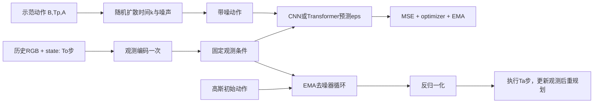

# Diffusion Policy：从动作噪声到滚动控制（RSS 2023）

目标：从零实现条件动作扩散，用 CNN 时间 U-Net 主线完成训练和控制，再实现 Transformer 去噪器复用同一个扩散闭环。前置：Tensor 广播、autograd、均值方差；Transformer 扩展另需 [foundations](../foundations/README.md) attention/mask。建议先读 [ACT](../act/README.md) 以理解 chunk，同时注意两者重规划和动作表示不同。

论文：Cheng Chi、Zhenjia Xu、Siyuan Feng 等，**Diffusion Policy: Visuomotor Policy Learning via Action Diffusion**，RSS 2023，[arXiv v1](https://arxiv.org/html/2303.04137v1)。主要依据 §II–III、Fig.3 与附录噪声日程；[官方实现](https://github.com/real-stanford/diffusion_policy)。不自动替换成 3D Diffusion Policy 或后续 flow policy。

## 第一步与学习顺序

从仓库根目录，在已安装 PyTorch 的环境执行：

```bash
PYTHONPATH=general_utils/edu_core python3 mllm/diffusion_policy/run_diffusion_policy_demo.py --implementation reference
PYTHONPATH=general_utils/edu_core python3 mllm/diffusion_policy/check_lessons.py --lesson 1
# 完成 1–7 关后运行 CNN practice；完成第 8 关后再运行 transformer：
PYTHONPATH=general_utils/edu_core python3 mllm/diffusion_policy/run_diffusion_policy_demo.py --implementation practice --backbone cnn
PYTHONPATH=general_utils/edu_core python3 mllm/diffusion_policy/run_diffusion_policy_demo.py --implementation practice --backbone transformer
```

demo 默认 reference，局部检查默认 practice。指定关卡时只将该关替换成学生函数，外围参考组件帮助独立定位；完整 practice 则所有核心函数都来自 lesson。未完成返回具体 TODO 和非零退出码，不吞掉真正的数值错误。

## 数据流、三个 horizon 与两种时间



环境时间 `t` 与扩散时间 `k` 是两条独立轴。一次网络前向同时预测所有 Tp 个动作的噪声；即使 Transformer 有因果 mask，也不需要像 OpenVLA 那样逐动作维 autoregressive decoding。

|符号|toy 默认|含义与形状|
|---|---|---|
|B|2|batch|
|To|2|已观察历史，RGB `(B,2,3,8,8)`，state `(B,2,4)`|
|Tp|8|预测窗口，动作/噪声 `(B,8,2)`|
|Ta|3|本轮实际执行 `(B,3,2)`|
|A|2|二维绝对位置 toy 动作，物理范围训练统计为 [-2,2]|
|F|16|每帧 12 维视觉特征 + 4 维 state|
|K|16|训练/标准 DDPM 采样扩散步数；DDIM 默认 4 步|

窗口起点为 `t-To+1`，所以当前时刻位于预测窗口 `To-1`，执行切片为 `[:,To-1:To-1+Ta]`。例如 `To=2,Ta=3`，预测编号 `[0,1,2,3,4,5,6,7]` 时执行 `[1,2,3]`。[官方视觉策略同样使用该起点](https://github.com/real-stanford/diffusion_policy/blob/main/diffusion_policy/policy/diffusion_unet_hybrid_image_policy.py)。不能直接拿 `[:Ta]`，也不使用 ACT temporal ensemble。

## 八关机制与手算

每关函数有已定签名、编号小任务、手算及错误提醒；模块参数全部在 `scaffolding.py` 初始化。[三级提示](HINTS.md)按需展开。

|关卡|内容|手算/不变量|
|---|---|---|
|1 轨迹与归一化|单 episode 窗口、首尾重复、训练集 bounds、逆变换|t=0,To=2,Tp=4：观测 `[0,0]`，动作 `[0,0,1,2]`|
|2 前向扩散|余弦日程、batch gather、重参数化|`a0=2,eps=0,alpha_bar=.25` → `a_k=1`|
|3 观测条件|合并 B/To 编图像，再拼 state|B=2,To=2 → 一次处理 4 张图，恢复 `(2,2,F)`|
|4 CNN 主线|时间 embedding、FiLM、残差、down/up/skip|`scale=2,bias=3,x=1` → 5；时间轴 8→4→8|
|5 训练与 EMA|噪声 MSE、参数更新、EMA|预测 `[1,3]`，噪声 `[0,1]` → loss=2.5|
|6 反向采样|DDPM 均值/方差、末步不加噪、DDIM 跳步|k=0 时改变随机噪声不能改变结果|
|7 滚动控制|执行切片、执行后重新观察|两轮事件顺序 observe→predict→execute→observe→…|
|8 Transformer 扩展|动作 tokens、条件 memory、位置、self/cross masks|action0 可见 `[time,o0]`，不能看 o1 或未来动作 token|

### 从公式写出可运行扩散

令 `alpha_k=1-beta_k`，`alpha_bar_k=prod_{s<=k} alpha_s`。前向加噪为：

```text
a_k = sqrt(alpha_bar_k) * a0 + sqrt(1-alpha_bar_k) * epsilon
loss = mean((epsilon_theta(a_k,k,obs) - epsilon)**2)
```

日程使用 `f(u)=cos²((u+.008)/1.008*pi/2)`，相邻比值得 beta，最大截断 `.999`，再累计实际 `1-beta`。噪声张量与动作同形；`k=(B,)` 索引后须 reshape 为 `(B,1,1)`。训练过程中视觉 encoder 和 denoiser 都由梯度更新，没有对条件 detach；优化器更新后才做 `theta_ema = decay*theta_ema + (1-decay)*theta`。

DDPM 一步（`p=alpha_bar_{k-1}`，k=0 时 p=1）：

```text
x0_hat = clip((a_k - sqrt(1-alpha_bar_k)*eps_hat)/sqrt(alpha_bar_k), -1,1)
mean = sqrt(p)*beta_k/(1-alpha_bar_k)*x0_hat
       + sqrt(alpha_k)*(1-p)/(1-alpha_bar_k)*a_k
variance = beta_k*(1-p)/(1-alpha_bar_k)
a_previous = mean + sqrt(variance)*z       # k=0 时不要加 z
```

DDIM 扩展采用 `eta=0`，任意较早时间 j：`a_j=sqrt(alpha_bar_j)*x0_hat+sqrt(1-alpha_bar_j)*eps_hat`，最后 j=-1 的累计系数取 1。toy 采用包含末端的递减 linspace 时间网格（16→4 步为 15/10/5/0），与外部 diffusers 的 leading spacing 配置不保证相同。采样初始噪声和每步噪声显式传入，便于手算与可重复验收。日程、反向更新均在本课程实现，不调用 diffusers scheduler。

demo 在建立 frozen/eval EMA 副本之前写入训练动作统计；共享 `update_ema` 只更新 parameters，不更新 schedule 或归一化 buffers。两边的不可变日程和统计来自同一次初始化，避免“参数更新正确但输出单位错误”。

### CNN 与 Transformer 共享什么

CNN 将动作转为 `(B,A,Tp)`；48 维条件来自 16 维时间 embedding 和展平的 `To*F=32` 维观测。每个残差块都做 `scale*x+bias`，保持[官方 scale-predicting FiLM](https://github.com/real-stanford/diffusion_policy/blob/main/diffusion_policy/model/diffusion/conditional_unet1d.py) 的约定；toy 仅一层下采样，完整练习 skip 的通道拼接。

Transformer 使用 `(B,Tp,32)` 动作序列；memory 为 `[time,o0,o1]`，形状 `(B,To+1,32)`。self allow mask 是下三角；cross allow 条件为 `action_index >= memory_index-1`，遵循[官方时间对齐 mask](https://github.com/real-stanford/diffusion_policy/blob/main/diffusion_policy/model/diffusion/transformer_for_diffusion.py)。共享 attention 约定 `True=允许`。新网络只替换 denoiser，归一化、加噪、损失、EMA、采样和滚动控制全部复用。

## 接口与文件

`build_toy_diffusion_policy(backbone="cnn") -> DiffusionPolicy`，也支持 `"transformer"`。

- `compute_loss(batch, noise, timesteps) -> scalar`；batch 为 `images/states/actions` 字典，形状见上表，输入动作仍为物理单位。
- `predict_action(images,states,initial_noise,step_noises,sampler="ddpm")` 返回 `action_pred=(B,8,2)` 和 `action=(B,3,2)`，均为物理单位；`step_noises=(16,B,8,2)`。`sampler="ddim"` 使用确定性少步路线。
- `ops.receding_rollout` 接收 `observe/execute` adapter，demo 用内存状态变化验证重规划的调用顺序，不接真实硬件。
- `reference_diffusion_policy.py` 是答案；`scaffolding.py` 是提供的模块构造与外层组装；`practice_diffusion_policy.py` 只注入学生函数。`lesson_registry.py` 仅记录关卡入口。

第一关给定单 episode，调用者逐 episode 采样，绝不在拼接数组中跨 episode 取窗口。重复填充动作和官方 sampler 一样参与训练，本课程不额外引入 ACT 的 valid-mask loss。状态由 demo 直接提供为已缩放特征；真实状态缩放和图像预处理见 recipe。

## 验收与真实路线

```bash
PYTHONPATH=general_utils/edu_core python3 mllm/diffusion_policy/check_lessons.py --implementation reference --backbone all
PYTHONPATH=general_utils/edu_core python3 mllm/diffusion_policy/check_wiring.py
python3 mllm/check_tutorials.py --paper diffusion_policy --implementation reference
python3 mllm/diffusion_policy/recipe/validate_config.py
```

统一入口自动覆盖两种网络；`--backbone all` 同样可用于 demo。第 8 关检查实际 Transformer 隔离；第 4 关始终检查 CNN，便于比较而非将其中一种略过。维护接线测试用替身逐函数计数，验证 CNN/Transformer 各自所有适用函数和训练入口，且不写回答案。

保留：条件动作扩散、square-cosine 日程、eps objective、CNN FiLM/Transformer mask、EMA、DDPM/DDIM、滚动预测和观测编码缓存。简化：随机小视觉 encoder+global average pooling 替代 ResNet/SpatialSoftmax/随机裁剪，单相机小图、固定 horizon、较少扩散步、小型网络、常量 EMA decay、合成单次训练；toy 不能加载论文 checkpoint。真实 recipe 覆盖 Push-T/robomimic 数据、官方模型/配置、训练及指标协议，不声称已训练或跑出论文成功率。

详见 [recipe/README.md](recipe/README.md) 和 [验证记录](../../docs/validation.md)。论文/源码核对日期：2026-10-16；官方 main 可能变化，复现须锁定其 commit。
