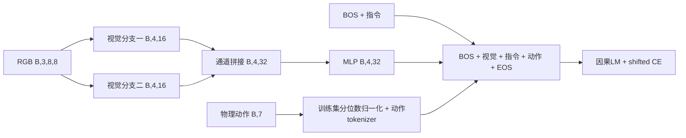

# OpenVLA：从连续动作到自回归 token（2024 原始版）

目标：自己完成动作归一化、离散化、双路视觉融合、多模态序列、动作损失、训练更新和自回归推理，最终在 CPU 上训练一个小型策略。默认你会 Python、Tensor 和 autograd；不要求你从空白函数设计语言模型。

采用 **OpenVLA: An Open-Source Vision-Language-Action Model**，Kim、Pertsch、Karamcheti 等，2024；机制依据 [arXiv v1，§3.1–3.4](https://arxiv.org/html/2406.09246v1)。这里是原始单步、逐动作维生成机制。原论文是在预训练 Prismatic VLM 上进行机器人动作训练，toy 从随机小模型开始，不能代表其语义能力或机器人成功率。

## 先运行，再动手

先完成 [foundations](../foundations/README.md) 的 patch、attention、mask；建议先读 [LLaVA](../llava/README.md) 的 labels/shift、[ACT](../act/README.md) 的动作单位。共享基础练一次，本课程复用 `edu_core`。

从仓库根目录，在已安装 PyTorch 的环境执行：

```bash
PYTHONPATH=general_utils/edu_core python3 mllm/openvla/run_openvla_demo.py --implementation reference
PYTHONPATH=general_utils/edu_core python3 mllm/openvla/check_lessons.py --lesson 1
# 填完后换关卡编号，最后运行自己的整模型：
PYTHONPATH=general_utils/edu_core python3 mllm/openvla/run_openvla_demo.py --implementation practice
```

默认局部检查使用 **practice**；demo 默认 **reference**。未填答案会显示 `lessonN.function` 并返回非零。局部检查只替换所选关的函数，提供前后关参考外围以便独立练习；通过某一关不代表完整 practice 已完成。

## 完整数据流与轴



`B` 为 batch，`N=4` 为共同 patch 网格数，语言维 `D=32`。原始策略预测 7 个维度：末端平移增量、旋转增量、夹爪控制；实际单位、坐标系和夹爪约定必须来自数据集 adapter，不能把它们当 ACT 的绝对关节位置。

训练时序列是 `[BOS, visual×N, prompt×P, action×7, EOS]`，总长 `1+N+P+7+1`；推理起始序列没有示范动作。训练目标只保留动作与默认开启的 EOS，其他标签 `-100`。padding mask 的 `True` 表示有效 key；共享 attention 的 `True` 表示允许注意。

所有视觉分支、projector 和 LM 参数均有梯度并由优化器更新。没有 teacher、stop-gradient 或 EMA；不要沿用 LLaVA 的冻结视觉默认值。

## 六关：从手算到整模型

每个 lesson 顶部有接入位置与局部命令；函数 docstring 包含形状、手算输入/输出、编号微任务。卡住时打开 [HINTS.md](HINTS.md)，依次展开思路、操作和伪代码。

|关卡|你实现什么|公式 / 手算|接入位置|
|---|---|---|---|
|1 动作归一化|训练分位数、mask、逆变换|`u=clip(2(a-q01)/(q99-q01)-1,-1,1)`；边界 0/10 时 5→0|训练输入与推理输出|
|2 动作 tokenizer|边界搜索、词表映射、中心解码|`token=V-digitize(u,edges)`；4 个边界时 -1/0/1→19/18/16（V=20）|动作转序列与输出解码|
|3 视觉融合|通道拼接和 projector|`z=MLP([v1;v2])`，`[1,2]` 与 `[3]`→`[1,2,3]`|`encode_images`|
|4 多模态序列|BOS 后插入、labels、EOS|`[1,8,64,65,2]`，A=2 → labels `[-100,-100,64,65,2]`|batch packing|
|5 训练|next-token CE、梯度更新|`CE(logits[:,:-1],labels[:,1:])`；不能 shift 两次|`training_step`|
|6 推理|固定维数逐 token 生成、解码与逆变换|第 k 维依赖已生成前 k-1 维，batch 每行读取自己的有效末位|`predict_action`|

第 4 关先做单行插入，变长 batch、右 padding、mask 已在 `scaffolding.py` 提供。第 6 关初始化行列表、每步更新与返回堆叠拆为编号步骤，不需要设计通用 tokenizer 或 beam search。

### 必须分清的离散边界

[官方 `ActionTokenizer`](https://github.com/openvla/openvla/blob/main/prismatic/vla/action_tokenizer.py) 默认 `linspace(-1,1,256)` 产生 **256 个边界、255 个中心**；`digitize` 返回 1…256，最后两个索引解码到同一末端中心。这和“256 个等宽区间、256 个中心”的另一种自然实现不同。本课程保留官方行为，测试精确端点，避免无意更换 tokenizer。

例如边界 `[-1,-1/3,1/3,1]`，中心 `[-2/3,0,2/3]`：值 1 的 ID 是 `V-4`，解码中心仍为 `2/3`。所以量化往返有误差，不应断言严格等于原动作。`torch.bucketize(..., right=True)` 才与这里的 `np.digitize(..., right=False)` 对齐。

官方 NumPy 边界采用 float64，本课程也在 float64 中构造边界并比较动作；不能只把边界换成 float32 后仍宣称索引完全兼容。解码结果为 float32，允许浮点舍入误差。检查器用独立的标量二分搜索验内部边界，覆盖常见 float32 输入。

推理采用**全词表** greedy argmax，固定生成 A 个 token。[官方 decoder](https://github.com/openvla/openvla/blob/main/prismatic/models/vlas/openvla.py) 对非动作 ID 也会裁剪中心索引；课程保留这一行为，不把随机小模型的任意文本 ID 输出伪装成学会了机器人控制。夹爪语义及离散阈值交给真实数据 adapter，本 toy 不新增阈值控制器。

## 文件与可替换接口

|文件|职责|
|---|---|
|`scaffolding.py`|初始化 TinyVision、TinyLanguage、OpenVLAPolicy；提供变长 batch 外围|
|`reference_openvla.py`|六关全部参考计算，可独立运行|
|`lesson1_*.py` … `lesson6_*.py`|学生关键计算，默认明确 TODO|
|`practice_openvla.py`|将所有 lesson 函数放入 ops；没有答案回退|
|`check_lessons.py` / `check_wiring.py`|语义检查 / 维护用测试替身接线|
|`recipe/`|真实数据、权重、算力与评估路线及配置检查|

`build_toy_openvla() -> OpenVLAPolicy`。`model(images,prompts,actions,stats)` 返回标量 loss；`model.predict_action(images,prompts,stats) -> Tensor(B,7)`。`images=(B,3,8,8)` float，`prompts` 为包含 BOS 的一维 long Tensor 列表，指令 token 在 `[3,63]`，`actions=(B,7)` float。`stats` 包含逐维 `q01/q99/mask`。词表大小 320，padding/BOS/EOS 分别为 0/1/2，动作占最后 256 个 ID。整个 toy 默认 CPU；真实环境的 tokenizer、图像预处理和统计键必须使用官方实现。

## 验收与边界

```bash
PYTHONPATH=general_utils/edu_core python3 mllm/openvla/check_lessons.py --implementation reference
PYTHONPATH=general_utils/edu_core python3 mllm/openvla/check_wiring.py
python3 mllm/check_tutorials.py --paper openvla --implementation reference
python3 mllm/openvla/recipe/validate_config.py
```

检查覆盖手算数值、分位数/夹爪 mask、边界 token、内容顺序、padding/因果隔离、shift、两视觉分支梯度、参数更新和固定输入生成可重复。接线测试只在维护测试中注入参考替身并计数，不填写 lesson，也不证明你已完成练习。

保留：双路视觉 channel fusion、projector、因果动作 token 预测、量化、动作/EOS 监督、全参数训练及反归一化。简化：8×8 RGB、随机微型视觉塔、32 维 LM、学习位置编码、toy 指令词表、两样本单次训练；固定生成 A 个 ID，不实现 Hugging Face generation 的 EOS 提前终止。没有 DINOv2/SigLIP 预训练、Llama 2、真实 BPE、RoPE、KV cache、RLDS 数据混合、LoRA 或分布式训练。不能直接加载官方权重。

真实路线见 [recipe/README.md](recipe/README.md)；实际运行证据见 [仓库验证记录](../../docs/validation.md)。来源核对日期：2026-10-16；官方代码链接指向可更新的 main，真实实验应锁定 checkout commit。


## 可复用预训练组件（2026-10-16）

[基础模型接口小课](../backbones/README.md)提供统一的显式下载、本地加载、图像/语言与K/V合同。
本课程默认toy与已有lesson签名保持；可选组件模式继续调用课程的projector/packing/训练机制，不直接用原生VLM输出代替。

```bash
PYTHONPATH=general_utils/edu_core python3 mllm/openvla/run_backbone_demo.py
PYTHONPATH=general_utils/edu_core python3 mllm/openvla/run_backbone_demo.py --implementation practice
```

SmolVLM模式只复用真实语言模型，双视觉分支保留toy，不能据此声称具备DINOv2+SigLIP预训练特征。动作codec选择最高的256个非特殊ID，避免覆盖图像/控制token，并显式包装学生量化/解码函数。默认toy的词表末端映射不变。此模式检验量化、loss/梯度与生成接线，不检验机器人成功率。
