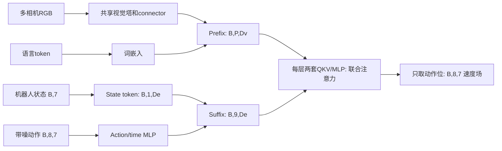

# π0：从 VLM 到连续动作专家（2024 原始版）

自己实现一条 `多相机图像 + 语言 + 状态 → action expert → 连续动作 chunk` 的训练/推理链路。不是把 Diffusion Policy 换一个 scheduler，也不是在 VLM 最后一个 hidden state 后接 MLP：本课程保留**逐层、独立参数、共享注意力空间**的双流结构。

论文：Physical Intelligence，**π0: A Vision-Language-Action Flow Model for General Robot Control**，2024，[arXiv v1 §IV、附录 A-B/A-D](https://arxiv.org/html/2410.24164v1)。代码依据 [openpi pi0.py](https://github.com/Physical-Intelligence/openpi/blob/main/src/openpi/models/pi0.py) 与 [PyTorch 双流实现](https://github.com/Physical-Intelligence/openpi/blob/main/src/openpi/models_pytorch/gemma_pytorch.py)。机制核对日期：2026-10-16。教程使用原始 π0 的 state token 与 action/time MLP，不使用 π0.5 的离散 state、adaRMS 或 KI 梯度隔离。

## 先做什么

你需要基础 Tensor、广播、autograd 和 attention mask。建议顺序：[基础 attention/mask](../foundations/README.md) → [OpenVLA](../openvla/README.md) 的 VLM/动作概念 → [Diffusion Policy](../diffusion_policy/README.md) 的连续动作采样 → 本课程。[共享基础模型接口小课](../backbones/README.md) 解释如何替换 toy 骨干与加载真实小模型。

从仓库根运行，选择已安装 torch 的 Python：

```bash
PYTHONPATH=general_utils/edu_core python3 mllm/pi0/run_pi0_demo.py --implementation reference
PYTHONPATH=general_utils/edu_core python3 mllm/pi0/check_lessons.py --lesson 1
# 完成一关后换编号；全部完成后运行自己的整模型：
PYTHONPATH=general_utils/edu_core python3 mllm/pi0/run_pi0_demo.py --implementation practice
```

demo 默认 reference；局部检查默认 practice。`NotImplementedError` 会显示 `lessonN.function` 并返回非零。单关检查提供其他关的参考外围，使你能独立定位错误；完整 practice 则把所有核心计算注入为学生函数，无答案回退。

## 数据流、形状与两套权重



默认 `B=2`，两相机 `(B,2,3,8,8)`，状态和动作维为 7，horizon `H=8`。tiny 每张图生成 4 个 token，`Dv=64`，`De=32`，两层 decoder，4 个 query heads、2 个 KV heads、head_dim=16。prefix 加上语言长度 L 后为 `P=2*4+L`。相机和文字 padding 均有独立 mask。

关键点：Dv 和 De 可不同；每层各自将 tokens 投影到**相同的 head 几何**，才能在 token 轴拼接 Q/K/V。注意力结束后，各自通过自己的输出映射、残差和 MLP。expert 的参数不与 VLM 共用。

|关卡|微任务|手算/核心不变量|整模型接入|
|---|---|---|---|
|1 观测与动作|当前时刻 action chunk、训练统计归一化、逆变换|episode `[0,1,2]`，t=1,H=4 → `[1,2,2,2]`|数据准备、训练/输出单位|
|2 Prefix/suffix|相机顺序与有效位、时间嵌入、state/action tokens|两个相机×4 tokens+3个字 → 11个prefix位；suffix=1+8|视觉/语言/动作表示|
|3 Mask/位置|三块可见性、有效位cumsum位置|prefix不能读动作；state不能读动作；动作全块双向|联合与缓存attention|
|4 双流 Transformer|联合QKV、双流多层、suffix读取缓存|joint与cache输出及梯度一致|速度场预测|
|5 Flow matching|Beta采样、噪声插值、速度目标、MSE|a=2,eps=0,t=.25 → x=1.5,u=-2|训练目标|
|6 训练更新|清梯度、forward、backward、optimizer|tiny视觉/VLM/expert均得到梯度|完整训练步|
|7 缓存控制|prefix K/V、Euler、执行片段、重规划|x=1.5,u=-2,dt=-.25 → 2|训练缓存路径与推理|

每个函数有形状、手算输入/输出和编号任务；模块初始化都在 `scaffolding.py`，不要求从一个空 def 设计整个模型。[HINTS.md](HINTS.md) 提供思路→张量操作→伪代码三级提示。

## 注意力到底允许谁看谁

将有效 tokens 分为三组：图像/语言 prefix=0，state=1，actions=2。允许 `key_group <= query_group`，再同时屏蔽无效 query/key。`True` 始终表示允许。

```text
                   keys
               prefix state actions
query prefix     yes    no     no
      state      yes    yes    no
      actions    yes    yes    yes
```

`position_ids=cumsum(valid)-1`，无效位不推进位置，负值只在 padding 处截到0。比如 `[1,1,0,1]` → `[0,1,1,2]`。动作不是逐 token 自回归生成：所有动作位每次共同预测速度，经过多次积分得到 chunk。

## Flow 时间：以官方代码为准，避免符号混用

本课程统一使用 **t=1 为噪声、t=0 为干净动作**，与官方 openpi 采样实现一致：

```text
t ~ .999 * Beta(1.5,1) + .001
x_t = t * epsilon + (1-t) * action
target_velocity = epsilon - action
loss = mean((predicted_velocity-target_velocity)^2)

推理：x=initial_noise
for i in 0..steps-1:
    t = 1-i/steps
    x = x + (-1/steps) * velocity(x,t,observation)
```

因此不能看到 `epsilon-action` 后又拿正步长从0积分到1。原始论文的插值时间采用相反方向，文中不同公式的符号需连同时间定义阅读；官方 `pi0.py:sample_actions` 明确说明其约定与论文相反。手算与 Euler 测试固定验证本课程这一套自洽合同。

模型输入的 batch 动作/状态是物理单位；在模型内按保存的 low/high 缩放。demo 的固定训练范围为 [-2,2]，不是由评估数据拟合；真实 recipe 使用数据集训练统计。每条 episode 独立取从当前时刻开始的 chunk，末尾重复，不能跨 episode。这里的执行切片是 `[:Ta]`，不同于 Diffusion Policy 的观测历史偏移。

## Prefix K/V 为什么能缓存

prefix 不读取 state/actions，所以其每层 K/V 与 flow 时间和采样动作无关。一轮规划先编码 prefix，再在每次 Euler 步读取同层 K/V；suffix 自己重新投影并旋转 K，只为本次 attention 临时拼接，**绝不追加到 prefix 缓存**。

缓存内的 key 已经带 RoPE。expert 使用相同 theta/head_dim，并给 state/actions 分配接在有效 prefix 后的位置。换相机、指令、batch 或任何观测后必须建立新缓存；本实现不跨规划存缓存。

tiny 默认使用联合前向训练、缓存采样。预训练 backend 的单向块结构允许先计算 prefix 再计算 suffix，数学上对应相同的路由；可训练缓存没有 detach。测试比较 tiny 两种执行路径的输出和对输入、VLM、expert 参数的梯度，而不只比较形状。

## 接口与真实小模型

`build_toy_pi0() -> Pi0Policy`；`model(batch,noise=None,time=None) -> scalar loss`；`model.predict_action(batch,initial_noise,steps=10) -> (B,8,7)` 物理动作。batch 含 `images/camera_valid/text_ids/text_valid/state/actions`，推理不读取 `actions`。`noise=(B,8,7)`、`time=(B,)` 可以显式固定。

tiny 默认视觉、语言和expert都训练。SmolVLM 模式默认 frozen/eval 基础模型，只更新专家；这是 CPU 接线实验，不等价于原论文端到端预训练。模型不使用 π0.5/KI 的 stop-gradient 配方冒充 π0。

先按[接口小课](../backbones/README.md)下载模型，再执行：

```bash
PYTHONPATH=general_utils/edu_core python3 mllm/pi0/run_pi0_demo.py --backbone smolvlm
PYTHONPATH=general_utils/edu_core python3 mllm/pi0/run_pi0_demo.py --backbone smolvlm --implementation practice
```

预训练路径采用真实 SmolVLM 的图像 connector、词嵌入和全部30层K/V，expert自动匹配9个query heads、3个KV heads、head_dim=64、theta=100000；不截取少数层冒充完整骨干。expert隐藏维仍为32以降低教学成本。图像组件路径用明确的方形resize和SigLIP mean/std，原生图文测试则使用官方 processor。

## 验收、简化与下一步

```bash
PYTHONPATH=general_utils/edu_core python3 mllm/pi0/check_lessons.py --implementation reference
PYTHONPATH=general_utils/edu_core python3 mllm/pi0/check_wiring.py
python3 mllm/check_tutorials.py --paper pi0 --implementation reference
python3 mllm/pi0/recipe/validate_config.py
```

维护接线测试用替身逐函数计数，验证学生 loss、训练步与采样都被调用；TODO和真实错误都传播，不补写答案。固定噪声的输出应可重复，但随机toy loss不要求持续下降。

保留机制：多相机/语言条件、state token、action/time MLP、两套逐层参数、块状注意力、flow目标、Beta时间采样、Euler与prefix缓存。toy 简化：随机微型VLM、8步/7维动作、简化FFN、固定归一化、单次更新；预训练扩展用 SmolVLM 替代 PaliGemma，冻结骨干、窄expert，并用组件式图像预处理替代原生chat布局。没有论文大数据混合、50步动作、实际控制频率、PaliGemma权重兼容或机器人成功率证明。

继续真实训练见 [recipe](recipe/README.md)；实际验证见[验证记录](../../docs/validation.md)。
